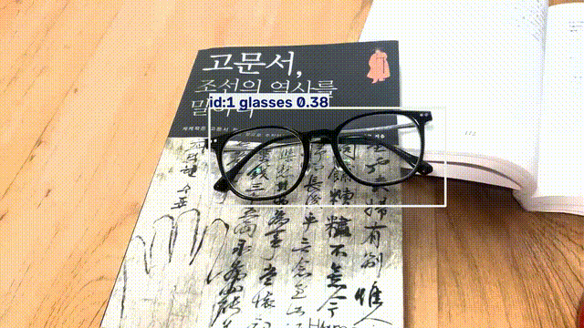

# YOLOv8 Fine-tuning: 컵 · 안경 · 책 객체 탐지 및 추적

머신러닝 과제 2 — 사전학습된 YOLOv8 모델을 3개 부류(cup, glasses, book) 데이터로 fine-tuning하고,
학습한 모델로 동영상에서 객체 탐지 및 추적(ByteTrack)을 수행했습니다.



▶ 원본 해상도 결과 영상: [tracking_5s.mp4](tracking_5s.mp4)

## 1. 데이터셋

| 항목 | 내용 |
|---|---|
| 부류 | `book`, `cup`, `glasses` (3개) |
| 이미지 수 | 144장 (Pixabay 무료 이미지에서 직접 선별) |
| 라벨링 도구 | Roboflow (bounding box 직접 라벨링) |
| 객체(박스) 수 | book 115, cup 75, glasses 52 (총 242) |
| 분할 | Train / Valid / Test ≈ 70 / 20 / 10 % (검증 28장) |
| 전처리 | Auto-Orient, 640×640 Fit (black edges) |
| 증강 | Roboflow 증강 없음 — YOLOv8 학습 시 기본 증강(mosaic, flip, HSV) 사용 |

## 2. 학습 설정

| 항목 | 값 |
|---|---|
| 모델 | YOLOv8s (COCO 사전학습 가중치 → fine-tuning) |
| 입력 크기 | 640 |
| Epochs | 100 |
| Batch | 8 |
| Early stopping | 사용 안 함 (`patience=0`) |
| 환경 | Google Colab, Tesla T4 GPU, Ultralytics 8.4 |

## 3. 성능 (검증 데이터 28장, 객체 55개)

| 지표 | 1차 학습 (조기 종료, 51 epoch) | 2차 학습 (100 epoch) |
|---|---|---|
| Precision | 0.612 | **0.780** |
| Recall | 0.674 | **0.846** |
| mAP@0.5 | 0.682 | **0.860** |
| mAP@0.5:0.95 | 0.529 | **0.580** |

| 부류별 mAP@0.5:0.95 | 1차 | 2차 |
|---|---|---|
| cup | 0.789 | **0.796** |
| glasses | 0.210 | **0.543** |
| book | **0.587** | 0.401 |

학습 곡선과 혼동행렬은 [`results/`](results) 폴더에 있습니다.

## 4. 객체 탐지 + 추적

- 직접 촬영한 5초 동영상(1920×1080, 30fps, 150프레임)에 `model.track()` (ByteTrack) 적용
- 객체마다 ID를 유지하고, 매 프레임 중심점을 이어 이동 궤적(노란 선)을 표시
- 궤적은 [`trajectory.csv`](trajectory.csv)에 프레임별로 저장 (frame, time, track_id, class, conf, cx, cy, w, h)

## 5. 파일 구성

```
├── best.pt               # fine-tuning된 YOLOv8s 가중치
├── data.yaml             # 데이터셋 설정 (클래스 정보)
├── tracking_5s.mp4       # 탐지 + 추적 결과 영상 (5초)
├── tracking_5s.gif       # README용 미리보기
├── trajectory.csv        # 객체별 이동 궤적 기록
└── results/              # 학습 곡선, 혼동행렬 등
```

## 6. 사용 방법

```python
from ultralytics import YOLO

model = YOLO('best.pt')
model.predict('image.jpg', conf=0.35, save=True)          # 이미지 탐지
model.track('video.mp4', tracker='bytetrack.yaml', save=True)  # 동영상 추적
```

## 출처

- 학습 이미지: [Pixabay](https://pixabay.com) (Pixabay Content License)
- 추적용 동영상: 직접 촬영
- 참고: [Ultralytics YOLOv8](https://github.com/ultralytics/ultralytics), [Roboflow](https://roboflow.com)
